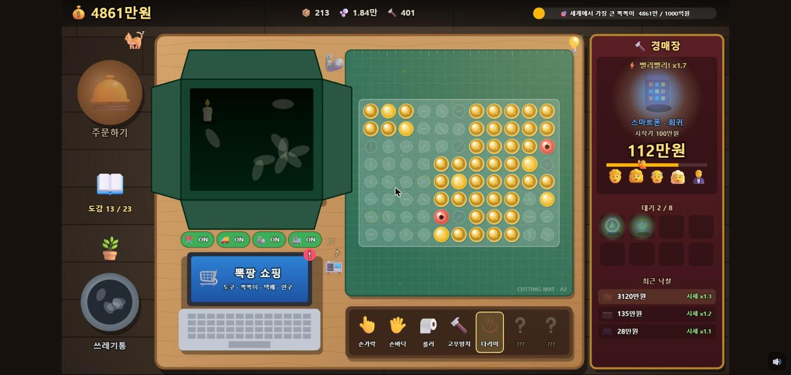

# 🫧 뽁뽁이 타이쿤

> 택배를 뜯고, 물건을 경매에 팔고, 뽁뽁이를 터뜨려서 부자가 되는 PC 타이쿤 게임

### 🎮 [지금 바로 플레이하기 → oh-bj.github.io/bubble-wrap-tycoon](https://oh-bj.github.io/bubble-wrap-tycoon/)



동네 택배 뜯는 알바생으로 시작해요. 처음엔 손가락으로 1원짜리 뽁뽁이를 하나씩 눌러 터뜨리지만, 돈을 모아 도구를 사고 기계를 들이다 보면 책상 위에서 로봇이 상자를 뜯고, 프레스가 쾅쾅 내리찍고, 수천만 원짜리 전설 물건이 경매에서 팔려 나가요. 마지막 목표는 **"세계에서 가장 큰 뽁뽁이"** 를 사서 직접 터뜨리는 것!

- ⏱️ 엔딩까지 **약 2시간 반 ~ 3시간 반**
- 💻 **PC 브라우저 권장** (마우스로 문지르는 게임이에요)
- 💾 진행 상황은 브라우저에 **자동 저장**돼요. 창을 닫았다 다시 와도 그대로예요.

---

## 🕹️ 조작법

| 하고 싶은 것 | 하는 법 |
|---|---|
| 택배 주문 | 왼쪽 🛎️ **주문벨** 클릭 |
| 상자 열기 | 상자 위 **테이프를 따라 위아래로 긁기** ✂️ |
| 물건 팔기 | 상자 속 물건을 오른쪽 🔨 **경매장으로 끌어다 놓기** → 시작가 정하기 |
| 뽁뽁이 펼치기 | 상자 속 뽁뽁이를 초록 **매트로 끌어다 놓기** |
| 뽁뽁이 터뜨리기 | 매트 위 뽁뽁이 **클릭** (🧤 쓱쓱 장갑을 사면 **드래그**로 줄줄이) |
| 치우기 | 다 쓴 시트와 빈 상자를 **클릭** → 🗑️ 쓰레기통으로 |
| 업그레이드 | 💻 **노트북** 클릭 → "뽁팡 쇼핑" |
| 도감 보기 | 왼쪽 📖 **도감** 클릭 |
| 기계 켜기/끄기 | 책상 위 **ON/OFF 스위치** |

---

## 📦 한 판의 흐름

1. 🛎️ **주문** → 상자가 책상에 "쿵!"
2. ✂️ **테이프 뜯기** → 희귀 물건이 들어 있으면 번쩍✨
3. 🔨 **경매에 올리기** → 손님들이 입찰하고 "땅땅땅! 낙찰"
4. 🫧 **뽁뽁이 펼쳐서 터뜨리기** → 💰
5. 🗑️ **치우고** 다음 택배 주문

경매가 진행되는 동안 다음 상자를 뜯을 수 있어요. 여러 일을 동시에 굴리는 게 타이쿤의 맛!

---

## 🔨 경매: 가격을 잘 맞춰라

물건을 경매장에 올리면 **시작가를 직접 정해요.** 진짜 시세는 숨겨져 있고 **예상 시세 범위**만 보여요.

| 시작가 | 결과 |
|---|---|
| 😊 싸게 | 무조건 팔리지만, 시세 근처까지만 올라요 |
| 🙂 적당히 | **평균적으로 가장 이득.** 손님끼리 경쟁해서 더 오르고, 🔥 **입찰 전쟁**이 터지면 몇 배에 팔려요 |
| 😱 욕심껏 | 손님들이 🙅 고개를 저어요. 안 팔리면 **떨이(손해)** 로 넘어가요 |

팔고 나면 **진짜 시세가 공개**돼요. 하다 보면 물건 값을 감으로 알게 돼요. 대기열이 쌓이면 경매사가 **⚡ 빨리빨리** 모드로 서둘러요.

---

## 🫧 뽁뽁이 8종

뽁뽁이마다 값, 단단함, 소리, 터지는 모습이 다 달라요. **도구 힘이 단단함보다 약하면 한 번에 안 터지고** 찌그러지거나 금만 가요. 여러 번 문질러야 해요!

| 뽁뽁이 | 한 알 | 단단함 | 특징 |
|---|---|---|---|
| 얇은 비닐 | 1원 | 1 | 톡! 손가락으로도 OK |
| 택배용 에어캡 | 6원 | 1 | 🍬 **줄무늬** 뽁뽁이: 한 줄이 통째로 터짐 |
| 두꺼운 에어캡 | 40원 | 3 | 고무처럼 말랑, **쉬면 다시 부풀어요** |
| 보냉 에어캡 | 250원 | 5 | ❄️ 얼음 금이 가고, 💣 폭탄이 섞여 있음 |
| 대왕 버블 | 1,500원 | 8 | 출렁출렁, 터지면 "펑!" 화면이 흔들림 |
| 황금 에어캡 | 8,000원 | 12 | 금속 찍힘, 터지면 동전이 쏟아짐 💰 |
| 무지개 에어캡 | 5만원 | 16 | 깎을수록 올라가는 실로폰 소리 🎶 |
| 다이아 에어캡 | 30만원 | 25 | 💎 유리처럼 쨍그랑! |

**특수 뽁뽁이** (연구로 해금): ✨ 황금(25배) · 💣 폭탄(주변 8칸 연쇄) · ✖️ x2(그 시트 수익 2배) · 🍬 줄무늬(한 줄 통째로). 빠르게 이어 터뜨리면 🔥 **콤보**!

---

## 📈 성장 (노트북 "뽁팡 쇼핑")

| 메뉴 | 내용 |
|---|---|
| 🖐️ **도구** | 손가락 → 손바닥 → 롤러 → 고무망치 → 다리미 → 유압 프레스 → 스팀롤러. 범위와 **힘**이 세져요 |
| 🫧 **뽁뽁이** | 다음 택배부터 더 비싸고 단단한 뽁뽁이가 와요 |
| 📦 **택배** | 동네 택배 → 대형 상자 → 해외 직구 → 미스터리 박스 → VIP 금고 상자 → 전설의 상자. 물건값과 희귀 확률이 올라가요 |
| 🔬 **연구** | 🧤 쓱쓱 장갑(드래그), 특수 뽁뽁이 해금, 콤보, 완벽주의 보너스, 감정사, 경매사, 홍보 |
| 🤖 **자동화** | 아래 참고 |
| 🪴 **꾸미기** | 💡 스탠드 · 🪴 화분 · 📻 라디오 · 🐈 고양이. 예쁘고 작은 혜택도 있어요 |

처음엔 한 판에 몇십 원이지만, 업그레이드할 때마다 수입이 **몇 배씩 뛰어요.** 후반엔 전설 물건 하나가 수천만 원!

### 🤖 자동화

| 기계 | 하는 일 |
|---|---|
| ✂️ 자동 커터 | 🤖가 테이프를 뜯어줘요. 최고 레벨은 **상자가 닿자마자 즉시 개봉** |
| 🚚 컨베이어 벨트 | 다 쓴 걸 치우고 다음 택배를 알아서 주문, 상자가 벨트를 타고 와요 |
| 🦾 정리 로봇팔 | 물건을 경매에 올리고 뽁뽁이를 펼쳐줘요. 레벨이 오르면 희귀, 전설까지 |
| 🏭 자동 프레스 | 강철 블록이 3x3을 쾅! 최고 레벨은 **황금까지** |

기계는 항상 "시세대로"만 팔고, 기계가 터뜨린 건 콤보가 안 붙어요. **손으로 잘하면 더 벌어요!**

---

## 📖 도감 · 🌍 엔딩

- **도감:** 23종의 물건을 모아요. 희귀도별로 다 모으면 **경매가가 영구히 올라요.**
- **엔딩:** 최종 상품 🌍 **"세계에서 가장 큰 뽁뽁이"** 를 사면 책상을 덮는 초대형 뽁뽁이가 배달돼요. 다 터뜨리면 엔딩! 그 뒤로도 계속 놀 수 있어요.

---

## 💡 팁

- 초반엔 **손바닥 → 롤러** 순으로 도구부터 올리면 편해요.
- 경매는 예상 시세의 **가운데보다 조금 높게** 부르는 게 보통 이득이에요.
- 단단한 뽁뽁이가 안 터지면 **더 좋은 도구**가 필요하다는 신호예요. 둘레의 링이 남은 내구도예요.
- 말랑한 뽁뽁이(두꺼운, 대왕 버블)는 쉬면 다시 부풀어요. **멈추지 말고 문질러요!**
- 처음 보는 물건은 📖 도감에 등록돼요. 다 모아보세요!

---

## 🛠️ 개발자용

TypeScript + Canvas 2D + Web Audio로 만들었어요. 외부 그림이나 소리 파일 없이 전부 코드로 그리고 합성해요.

```bash
npm install      # 처음 한 번
npm run dev      # 개발 서버 → http://localhost:5173
npm test         # 게임 규칙 / 껐다 켜기 테스트
npm run build    # 배포용 파일 → dist/
```

- `main` 브랜치에 올리면 **테스트 → 빌드 → GitHub Pages 배포**가 자동으로 진행돼요 (`.github/workflows/deploy.yml`).
- 밸런스 수치는 `src/economy/catalog.ts`, `src/config.ts`에 모여 있어요.
- 밸런스 시뮬레이션 (봇이 엔딩까지 플레이): `SIM=1 npx vitest run src/economy/sim.test.ts --silent=false`
- 가격 자동 조율: `SIM=tune TOTAL=125 npx vitest run src/economy/sim.test.ts --silent=false`
- 실제 녹음 효과음을 쓰려면 `public/sounds/`에 파일과 `manifest.json`을 넣으면 돼요 (`src/fx/samples.ts` 참고). 없는 소리는 합성음으로 나와요.
- 개발용: 주소 뒤에 `?reset` → 그 주소의 세이브 초기화. 개발 서버에서는 콘솔에서 `__game.state`로 상태 확인 가능.
- 기획과 상세 수치: [PLAN.md](PLAN.md)

```
src/
├─ main.ts       화면 크기 맞춤, 입력, 저장, 루프
├─ core/         게임 규칙, 저장/불러오기 (+ 테스트)
├─ economy/      도구/뽁뽁이/택배/물건/연구/자동화 정의, 밸런스 시뮬레이션
├─ scene/        책상, 상자, 뽁뽁이, 경매장, 기계 그리기와 조작
├─ fx/           소리, 파티클, 화면 흔들림
└─ ui/           노트북 상점, 경매 가격 정하기, 도감
```
